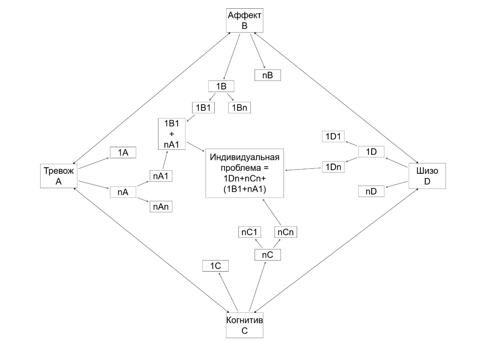
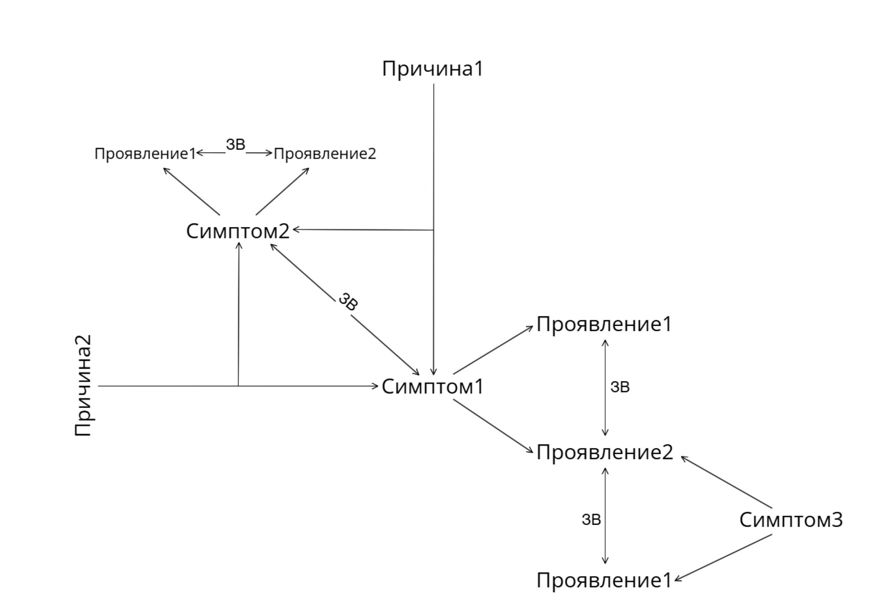
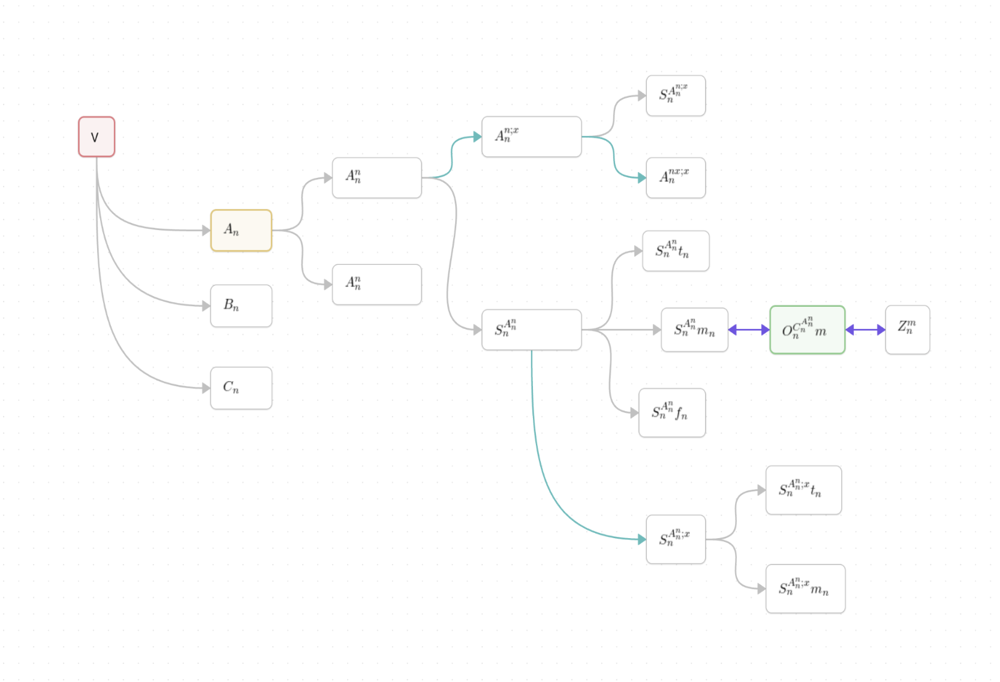
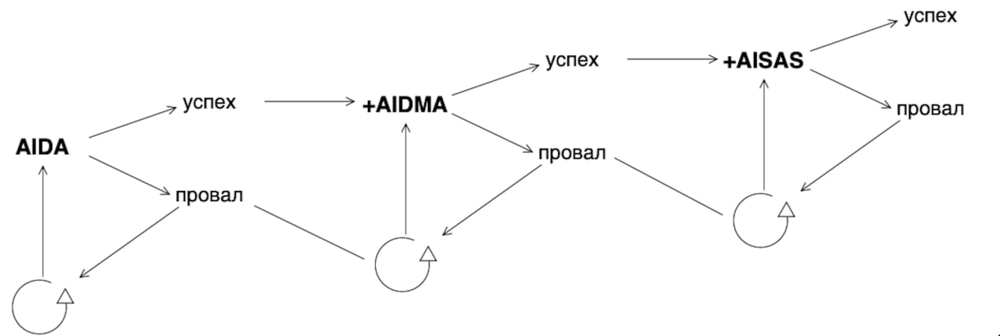

# МАРСИ: как переосмысление психиатрии привело меня к детерминированному движку решений и к двум работающим продуктам

Основная идея, вокруг которой построена вся эта история, у меня появилась давно и заключается в следующем: фундаментальные алгоритмы взаимодействия объектов и событий в нашем мире имеют «одни корни» в своём математическом виде. Бизнес-процесс буксует, воронка продаж не конвертит, у человека личный кризис - с точки зрения алгоритма это один и тот же класс задач: огромный неструктурированный монолит, который мы почему-то упорно пытаемся лечить целиком, а не по частям.

В этой статье я покажу, как я от нового взгляда на психиатрию и лечение психических расстройств пришёл к созданию технически специализированного алгоритма - **МАРСИ (Метод Атомарного Разделения и Сопоставления Информации)**, и как потом этот же движок заработал и в планировщике выставочных стендов, и в Telegram-боте для матчинга вакансий. Всё, о чем будет написано ниже - не теоретизирование на коленке: два проекта из статьи (и другие проекты, не вошедшие в статью) лежат на моем гитхабе, ссылка на которую будет в конце материала.

## 1. Введение: проблема монолитов и хаоса

С чего все начиналось.

Каждый человек имеет собственное, отличное от всех остальных виденье мира и интерпретирование реальности. Фундамент восприятия у человека - причинно-следственные связи и их проявление во внешнем мире: мозг построен так, чтобы замечать закономерности и обучаться. Но ведь все научные открытия, изобретения, произведения искусства, философские учения и физические догмы созданы, изучены и поняты человеком путём сложной классификации каждой отдельной «ячейки» от «одной большой картины мира». И именно порядок составления работы, порядок поиска истины, порядок выстраивания предположений - это и есть фундаментальные алгоритмы мышления. А программирование изначально было зеркальным отражением этих алгоритмов - от самых примитивных до самых сложных, просто в самом оптимизированном виде.

В МАРСИ я складываю природную гениальность функционирования живых систем с программной точностью и оптимизацией этого «природного гения».

### Вставка из моих заметок по психиатрии

Чтобы было понятно, откуда вообще растут ноги, приведу кусок своих старых заметок почти без правок (сразу оговорюсь: я не врач, и это исследовательский концепт, а не клиническая методика):

> Проблема симптомов в том, что для правильной их трактовки следует учитывать куда больше факторов, чем учитывается на данный момент. Также эти факторы будут полезны не только для лечения этих симптомов, но ещё и для понимания, стоит ли их лечить вообще. Понимание самого возникновения симптомов лучше скажется как на самом индивиде, так и на правильном подборе терапии. Кластеризация симптомов позволит относиться к ним как к личностным особенностям, особенностям сознания. Самая главная проблема сейчас - блокировать/лечить всё то, что хоть чем-то отличается от нормы. Наш подход хочет сместить этот устаревший взгляд новым: не всё нужно лечить, а даже наоборот - развивать, и наш метод поможет отделить положительные проявления от негативных и подобрать терапию, основывающуюся на развитии сильных/положительных черт и работе над негативными.

Отсюда вытекала первая ключевая идея - отказаться от разделения расстройств и перевести систему в сочетания симптомов с их более глубоким изучением:



*Рис. 1 — мое представление «диагноза» как «Индивидуальной проблемы» через простейшее уравнение с произвольными переменными через выделенные 4 «столпа» психики.*

```
Симп. + Симп. + Симп. + Симп. = синдром
Расчёт выраженности симптомов => диагноз
```

Узнаёте паттерн? Это как раз классическая декомпозиция монолита, просто в области функционирования психики человека.



*Рис. 2 — зона валентности.*

И вторая идея, которую я нечаянно выявил для симптомов, а потом переложил в метод - **зона валентности**. На схеме (Рис. 2) показано, что две разных причины могут вызывать одинаковый симптом, и не один - одна и та же причина может вызывать множество различных симптомов. В то же время один симптом может иметь разные проявления, которые, в свою очередь, могут пересекаться в нескольких симптомах: два разных симптома могут вызывать одинаковые проявления. Это сочетается с причинами возникновения как с дополнительными факторами протекания - берётся не одна лишь причина, а весь путь проявления, где объясняется, почему именно из-за этой причины был вызван именно этот симптом.

В один день, перекладывая старые бумаги, я наткнулся на эти заметки, перечитал их, представил графически, и стало очевидно, что передо мной не «заметки про психиатрию», а общий алгоритмический знаменатель для любых сложных систем. Так родился МАРСИ.

## 2. Архитектурный каркас: от «симптомов» к атомарным ячейкам

Основой метода является принцип декомпозиции монолита. Подобно микросервисной архитектуре или ECS, метод разбивает глобальную проблему на атомарные единицы:

- **Монолит (Проблема):** исходный неструктурированный запрос ($V=\infty \pm (W^v+r^v)+\epsilon$)
- **Аспекты (Категории):** сферы жизни или системы, затронутые проблемой
- **Симптомы (Микро-задачи):** атомарные ячейки состояния ($A_n$), требующие точечного решения
- **Микро-методы (Решения):** изолированные закрывающие проблему шаги, хранящиеся в базе данных, которые алгоритм назначает для каждой ячейки



*Рис. 3 — декомпозиция монолита: от общей картины к атомарным ячейкам и их причинам.*

На схеме: красная $V$ обозначает общую рассматриваемую картину, $A_n$ - рассматриваемая верхняя (по иерархии) ячейка, голубые стрелки - возможное продолжение раскрытия ячейки или симптома ($S$), зеленая ячейка - найденная причина к симптому, фиолетовые стрелки - «зона валентности». При переходе от ячейки $A_n^{n;x}$ к ячейке $A_n^{nx;x}$ предыдущий $x$ привязывается к $n$ прошлой ячейки - то есть углубление в проблему не теряет связь с родителем.

### Что считается ячейкой

**Ячейка ($A_n$)** - это атомарное, изолированное состояние системы в конкретный момент времени, имеющее измеримые параметры (ущерб, срочность). Граница ячейки определяется невозможностью её дальнейшего дробления без потери смысла: если «ошибка базы данных» делится на «сбой диска» и «сбой сети» - это разные ячейки. Если делить дальше некуда - это атомарная ячейка.

При этом одна микро-задача может принадлежать разным кластерам: на графе это узел, в который входят рёбра от нескольких родительских проблем (мульти-зависимость). А неделимые или неясные явления обрабатываются как «чёрные ящики»: их внутренность не анализируется, но внешнее влияние на систему оценивается через коэффициент неопределённости $\epsilon$.

### Почему это эффективнее линейных диагнозов и «слепых» промптов

Здесь стоит остановиться, потому что это главный тезис всей статьи.

LLM работает на семантике: она подбирает слова, которые статистически часто стоят рядом в её обучающей выборке. Она не понимает логики. Если спросить у нейросети «что мне делать с бизнесом», она выдаст усреднённый ответ из обучающей выборки - без учёта Ваших ресурсов, без понимания, что метод A конфликтует с методом B, и уж точно без гарантии воспроизводимости.

Ядро МАРСИ понимает топологию. Оно видит противопоказания. Если микро-метод $A$ конфликтует с методом $B$, математическое ядро присвоит ребру между ними отрицательный вес ($\Phi<0$), и они никогда не окажутся в одном плане рядом. LLM без этого ядра на такое не способна в принципе.

Итого против «жёстких линейных диагнозов» (симптомы считаются независимыми, лечение назначается всем сразу) и против «слепых промптов» (стохастика без модели системы) атомарный подход даёт три вещи: точечное применение решений, учёт взаимодействий между ними и полную объяснимость и воспроизводимость результата.

## 3. Математическое ядро движка состояний

Центральное ядро алгоритма - вычисление «веса» и состояния каждой проблемы. Модель эволюционировала от статичного снимка к динамическому фрактальному движку.

### Нормализация: от «нравится/не нравится» к числам

Первое, что пришлось сделать - перейти с качественных оценок на строгие. Все параметры ячейки нормализуются в числа от 0.0 до 1.0:

- **0** - полное отсутствие влияния параметра
- **1.0** - максимальная критичность или предельная нагрузка

При этом разнородные метрики (финансовый ущерб в миллионах и время в секундах) имеют разный масштаб, поэтому применяется логарифм корреляции между аспектами в разных ячейках - он «сплющивает» экстремальные выбросы и приводит любые объективные значения к плавной, сопоставимой шкале без потери пропорций. Вся неизвестность (неучтённые факторы, скрытые переменные) поглощается коэффициентом энтропии $\epsilon$ - это защищает систему от ступора на вопросе «а сколько это в цифрах?».

### Базовая формула (статика)

Первичное уравнение описывает состояние ячейки «здесь и сейчас»:

$$A_n(i+1) = \big( C_n^{t} + D_n^{m} + E_n^{f} + F_n^{e} + G_n^{y} + H_n^{g} + I_n^{h} \big) \cdot r_{obj}^{A_{n}} + \epsilon$$

Где:
- $t$ - время, $m$ - контекст пространства, $f$ - факты реальности, $e$ - сознательная цель, $y$ - критичность ущерба, $g$ - достоверность/уверенность в данных, $h$ - ценность решения/ROI
- $r_{obj}^{A_{n}}$ - общие энергозатраты на решение ячейки (ограничитель: система не назначит решение, на которое нет сил/бюджета)
- $\epsilon$ - коэффициент энтропии
- $C;D;E;F;G;H;I$ - обозначения микро-задач в рассматриваемой ячейке

Содержательный смысл операций: сложение агрегирует независимые веса параметров, умножение на $r$ выступает ограничителем - масштабирует проблему в зависимости от физически доступных ресурсов системы или человека.

### Универсальная фрактальная формула (динамика)

Новый вид формулы учитывает итеративность, энергозатраты системы и погрешность. Это делает алгоритм применимым к реальным условиям непредсказуемости:

$$A_{n(i+1)} = \left( \left( \left[ C_n^{A_n} + ((W_t^{C_n} + r_{W^t}^{C_n}) + (W_m^{C_n} + r_{W^m}^{C_n}) + \dots) \times \left(\frac{r_{W_{obj}}^{C_n}}{r^{O^{C_n}}_{w^C_n} + r^{O^{C_1}}_{w^C_n} + \dots} + \frac{r_{O_n}^{A_n}}{r^{C_n} + r_{O_1}^{C_n} + \dots}\right)\right] + \left[ D_n^{A_n} + \dots \right]+ \dots\right)\times r^{O^{A_n}}_{w_{obj}} \right) + \epsilon$$

| Переменная          | Семантика и роль в алгоритме                                                                                     |
| ------------------- | ---------------------------------------------------------------------------------------------------------------- |
| $A_{n(i+1)}$        | Итеративное состояние ячейки (проблемы) на следующем цикле работы системы                                        |
| $W_t, W_m, W_{obj}$ | Весовые коэффициенты параметров. Позволяет алгоритму приоритизировать факторы (например, критичность по времени) |
| $r, r^{O^{C_n}}$    | Ресурсозатраты (энергия). Не позволяют назначить решение, на которое у пользователя нет сил/бюджета              |
| $\epsilon$          | Коэффициент энтропии. Компенсирует неизбежный информационный «шум» и скрытые факторы при парсинге                |

Фрактальность здесь - это масштабная инвариантность: формула универсально применима ко всем уровням декомпозиции. Чем глубже уровень детализации (от глобального жизненного кризиса до лёгкого тремора рук), тем объёмнее становится запись, но ядро расчёта не меняется.

Вес отдельной ячейки считается так:

$$W^{A_n}_{i+1}=(A_{n}^{t^{w}}+ A_{n}^{m^{w}}+ A_{n}^{f^{w}}+ A_{n}^{e^{w}}+ A_{n}^{y^{w}}+ A_{n}^{g^{w}}+ A_{n}^{h^{w}})+\epsilon$$

### Топологический граф и математика «клея» ($\Phi_{jk}$)

Помимо оценки состояния изолированной ячейки, алгоритм использует направленный граф для вычисления взаимодействия узлов. Это и формирует «зону валентности» - определение первопричины и связи «симптомов»:

$$A_n^n \longleftarrow O_A^n \longrightarrow Z_n^n$$

Итоговая формула перекрёстного взаимодействия:

$$B_{O_n}^{A_n} = \frac{A_n}{V} R \frac{O_n}{A_n - Z_n}, \quad \text{if } (A_n-Z_n)=0, \text{ then } +1$$

Важный нюанс, который часто приходится объяснять: центральность показывает, с каким узлом связано больше всего других узлов, но первопричина ($Z_n$) - это узел, математическое обнуление которого (интервенция) даёт максимальное снижение общего ущерба всей системы. Это не одно и то же. Стрелка от $A$ к $B$ означает «изменение $A$ гарантированно приведёт к изменению $B$» - это причинность, а не корреляция.

Зона валентности в итоговом виде - это не абстрактная область, а схема-реле: промежуток между абстрактным состоянием и корневой причиной, в котором происходит переключение состояний с помощью подобранных микро-методов.

А чтобы изолированные микро-решения не конфликтовали друг с другом при объединении, используется строгая функция взаимодействия - «клей»:

$$\text{КЛЕЙ}_{\text{итоговый}}=\sum{W_i}-\sum{r_i}+\sum{\Phi_{jk}}-\epsilon$$

Где $\sum{W_i}$ - сумма весов решаемых ячеек, $\sum{r_i}$ - суммарные ресурсозатраты, $\sum{\Phi_{jk}}$ - сумма всех эффектов между всеми парами назначенных микро-методов. Как работает $\Phi_{jk}$:

- $\Phi_{jk}>0$ - **синергия**: методы усиливают друг друга, алгоритм отдаст предпочтение такой комбинации
- $\Phi_{jk}=0$ - **нейтральность**: методы не влияют друг на друга
- $\Phi_{jk}<0$ - **конфликт/антагонизм**: алгоритм получит штраф за такую склейку
- $\Phi_{jk}=-\infty$ - **абсолютное противопоказание**: алгоритму запрещено назначать их вместе

По сути, это «лекарственные взаимодействия» для любых методов - от тактик продаж до психотерапевтических интервенций. Сопоставление методов и задач идёт через векторы: каждая микро-задача и метод решения существуют в едином многомерном пространстве параметров, корневая причина $Z_n$ - центр притяжения, и по евклидову расстоянию или косинусному сходству алгоритм ищет метод, вектор которого максимально близок к вектору $A_n$ и направлен в сторону нейтрализации $Z_n$. Если определённые методы стабильно показывают высокий вес эффективности $W$ и ресурсной адекватности $r$, алгоритм повышает их внутренний рейтинг - индекс доверия.

### Пайплайн целиком

1. **Сбор данных (парсинг):** пользователь описывает проблему. Система собирает цифровые значения метрик ($t, m, f, e, y, g, h$) и переводит их в нормализованные числа от 0.0 до 1.0.
2. **Вычисление состояний:** бэкенд прогоняет данные через формулу $A_{n(i+1)}$, присваивая каждой микро-задаче индекс критичности с учётом ресурсов $r$ и погрешности $\epsilon$.
3. **Построение графа:** создаётся топологическая карта связей, вычисляется приоритет $B_{O_n}^{A_n}$, выявляется корневая проблема.
4. **Семантическое сопоставление (БД):** алгоритм подбирает из базы данных через интеграцию с LLM (по уже оцифрованным ядром данным) наиболее релевантные микро-методы.
5. **Склейка плана:** разрозненные решения собираются в единый индивидуальный протокол. Наивысший приоритет - узлам с максимальным «весом».

Временной шаг ($i \to i+1$) происходит после того, как пользователь или система выполнили один предложенный микро-метод и дали обратную связь - алгоритм пересчитывает формулу состояния, перестраивает веса в графе и выдаёт следующий приоритетный шаг.

И на вопрос «а можно ли без нейросетей?» ответ - да, абсолютно: LLM выступает исключительно в роли парсера (текст → строгий JSON с цифрами), и если заменить текстовый ввод на пошаговое интерактивное анкетирование, программа работает чисто на детерминированном коде, без риска нейросетевых галлюцинаций.

## 4. Практическое применение: воронки, выставки и реальный мир

Откуда пошли идеи - разобрались, теперь о том, как абстрактное ядро легло на реальные рельсы. Я сознательно выбрал проверочной площадкой выставочную деятельность, потому что это эталонная среда для формулы. Ограниченное время, живой поток людей, мгновенная обратная связь, куча тактик с известными эффектами - и всё это офлайн, то есть там, куда софт обычно не дотягивается.

### Главная мысль

Любое воздействие из внешнего мира вызывает ответную реакцию в мозге человека. Следовательно, если выяснить, какие конкретные внешние стимулы вызывают конкретные реакции у покупателя, можно прогнозировать его поведение на пути к покупке. Воронку «холодный → горячий» можно представить в математическом виде и автоматически управлять воздействием, выбирая самый оптимальный вариант пути для конкретного покупателя.

И вторая формулировка, которая мне нравится даже больше: **любое действие в торговле - это обмен весами параметров между сущностями сделки**: продукта, покупателя и задействованных средств. В конечном итоге приводящий либо к заключению контракта, либо нет.

### Тактики как операторы

Я собрал и описал базу тактик - для выставочной деятельности и общей торговли:

**Выставочные:** живая демонстрация (продукт в действии, мастер-классы, тестирование в реальном времени), закрытая зона (ограничение доступа к экспонатам и переговорам для общего потока), квалифицированное интервью (за 1-3 минуты отсеять «глазеющих» и выявить целевых клиентов с реальным бюджетом), партизанский маркетинг (малобюджетная нестандартная тактика с ставкой на креатив и эмоции).

**Из общей торговли:** дефицит и срочность, эмоциональное воздействие (большинство решений о покупке принимаются иррационально и лишь затем логически обосновываются), алгоритмический апсейл, лосс-лидер. Плюс дополнительная тактика системной интеграции - объединение CRM, ERP, склада, кассы и интернет-магазина в единую экосистему.

Каждая тактика - это оператор, изменяющий веса параметров и у покупателя, и у продавца. Ведь продавец-то тоже не бесплатно «расплачивается» за тактику: у каждой свой бюджет и своя нагрузка.

### Этапы воронки

Этапы выставочной деятельности соотносятся в прямой корреляции с классикой:

- **TOFU** (предвыставочный этап) - знакомство с темой, максимум охвата
- **MOFU** (выставочный этап) - рассмотрение и оценка, доверие к бренду
- **BOFU** (поствыставочный этап) - принятие решения, превращение интереса в сделку

Каждый этап делится на подэтапы по AIDA / AIDMA / AISAS, и успех считается по порогам «нужных» весов параметров плюс ограниченное количество действий на прохождение порога. Если порог не преодолевается - алгоритм повторяет работу уже с учётом новых данных и подбирает другое решение. При потере веса нужных параметров - возвращение к исходному пути через «возвратные тактики». Сброс интереса - это полная потеря клиента, результат $=-1$ (абсолютный холод), но причина и путь сброса фиксируются.

### Параметры и углы преломления

Два вида параметров. **Параметры продукта** (отношение к продукту со стороны покупателя): доверие, связь каналов, конверсия, длина воронки, CAC, внимание, интерес, желание, действие, мотивация, память, отзыв, потребность, когнитивные искажения, эмоции, убеждения/ценности, социальное влияние - все на отрезке от -1 до +1, где 0 - изначальное состояние.

**Параметры покупателя**: страх, тревога, принадлежность, признание, радость, удовольствие, надежда, ностальгия, вина, эмпатия, жажда взаимности, любопытство, интрига, стремление к лени, авторитетность/экспертность, «враг»/«друг», противопоставление, последовательность (внутреннее согласие) - каждый соотносится со своей Zone (<-> Z), оценка происходит через соотношение абсолютного значения параметра с его противоположностью.

Отсюда - «углы преломления». Соотношение весов параметров покупателя и продавца в приведённом виде шкалы -1…+1 геометрически выражается углами на ломаной траектории пути. Углы - это то, что отдают и получают сущности сделки. Каждая тактика (преломление) изменяет вес всех параметров между покупателем и продуктом, отсюда высчитывается угол и направление преломления. Белые прямоугольники на схеме - альтернативные методы/тактики, которые могут как повышать мотивацию (+1), так и понижать (-1) - понижение сделано не просто так: при нескольких целях тактика с минусом может, допустим, вести к покупке сопутствующих товаров. Это «альтернативные пути».



*Рис. 4 — путь по этапам воронки: «успех» переводит на следующий этап, «провал» возвращает в цикл — альтернативные пути.*

Весы параметров меняются индивидуально под каждого покупателя, исходя из его обобщённого социологического, биологического и психологического профиля. Так как оценить каждого человека по 30+ параметрам за две минуты невозможно, профили берутся обобщённые - по виду выставки, геополитике, возрасту и полу, а остальное - из социологических, маркетинговых и психологических исследований.

### Калибровка по Чалдини

Веса не берутся с потолка - они калибруются по опубликованным мета-анализам психологии влияния. Обобщённые данные по триггерам Чалдини:

| Триггер | Средний размер эффекта (r) | Сила влияния |
|---|---|---|
| Дефицит | 0.18–0.28 | Высокая |
| Социальное доказательство | 0.15–0.22 | Средняя/Высокая |
| Взаимность | 0.16–0.24 | Средняя |
| Авторитет | 0.12–0.19 | Средняя |
| Обязательность | 0.11–0.18 | Умеренная |
| Симпатия | 0.08–0.14 | Низкая/Средняя |

Приятные детали из мета-анализов, которые ложатся в калибровку: ограничение по количеству ("осталось 2 товара") стимулирует сильнее, чем ограничение по времени; люди реагируют не на «абстрактное большинство», а на «себе подобных» (фраза «80% гостей этого номера…» работает на 20–30% эффективнее, чем «80% гостей этого отеля…»). И жёсткие анти-паттерны: если потребитель распознаёт триггер как явную манипуляцию, включается психологическое сопротивление, и эффект становится отрицательным, а за 2020-2026 годы доверие к плашкам «этот отель смотрят ещё 15 человек» сильно просело - у людей выработался иммунитет.

### Честно о слабых местах

Здесь я сознательно не буду делать вид, что всё идеально — тем более что это первое, к чему придерётся любой грамотный рецензент:

1. **Детерминизм против стохастики.** Человеческое поведение вероятностно. Жёсткая формула с порогами рискует давать псевдоточность. Лечится вероятностными переходами (softmax поверх весов) и байесовским обновлением весов по данным.
2. **Проблема идентификации параметров.** Откуда взять реальные значения 30+ психологических параметров конкретного покупателя за 2 минуты? Это проблема "холодного" старта, единственное что сейчас реалистично - усреднённые профили.
3. **Циркулярная валидация.** «Симуляция подтверждается симуляцией» - замкнутый круг. Нужна привязка к реальности: данные с реальной выставки или хотя бы экспертная разметка.

Формализовать всё это честнее всего как марковский процесс принятия решений (MDP): состояние покупателя - вектор $s \in [-1;1]^n$, тактика - оператор, переводящий $s \to s'$, награда - целевое действие минус затраты на тактику. Тогда «угол» получает строгий смысл (косинусная близость векторов до/после), а «оптимальная воронка» - строгий алгоритм поиска. По сути, это Next Best Action - только для офлайн-стенда: на каждом шаге система выбирает следующее действие, максимизирующее вероятность целевого события, и динамически переключает шаг в зависимости от реакции. Собственно, в продакшене я так и сделал - см. ниже.

## 5. Боевое крещение: MarsiBisPlan и MarsiJob

Теория теорией, но я хотел проверить, что ядро живёт не только "на бумаге". Сейчас у меня два проекта, где МАРСИ проверяется продакшеном - оба в открытых репозиториях.

> **Важная оговорка перед тем, как мы перейдем к коду:**  
> Изначально в своих заметках я пытался описать этот движок через громоздкие фрактальные уравнения (с кучей индексов и попыткой учесть вообще всё). Но когда дело дошло до практики и написания кода, стало очевидно: усложнять не нужно. В продакшене вся эта «высшая математика» изящно схлопнулась в детерминированную взвешенную сумму параметров, матрицу штрафов ($\Phi _{jk}$) и нормализацию. Поэтому далее я буду показывать алгоритм именно в том виде, в котором он реально работает в коде, без академического усложнения.

### MarsiBisPlan: планировщик стендов с симуляцией на 10 000 посетителей

**[MarsiBisPlan](https://github.com/KlysSG13/MarsiBisPlan)** - научно обоснованный планировщик коммерческих пространств: выставочных стендов, магазинов, витрин. Четыре слоя архитектуры:

1. **Декомпозиция (метод МАРСИ).** Объект режется на атомарные зоны, каждая оценивается 8 вопросами по шкале 0-1 (те самые $t, m, f, e, y, g, h, r$), считается вес зоны, выделяется корневая зона ★ - точка максимального влияния. Есть пошаговая анкета с кнопкой «Не знаю», которая честно ставит среднее и снижает достоверность оценки.
2. **Воронка продаж (марковский процесс).** Состояние посетителя на шкале «холод → горячо» (-1…+1), этапы TOFU → MOFU → BOFU, приёмы продаж со стохастическими эффектами и стоимостью. Оптимальная стратегия $\pi^*$ ищется динамическим программированием (обратный ход), отклонения шагов фиксируются как углы $\varphi$ - та самая геометрия из практической адаптации, наконец посчитанная по настоящему.
3. **Композиция («клей» $\Phi_{jk}$).** Совместимость пар зон: синергия / конфликт / запрет. Компоновщик собирает лучший набор зон в рамках бюджета.
4. **Имитационная проверка.** 10 000 виртуальных посетителей прогоняются в фоновом Web Worker с сидированным ГПСЧ (доступна воспроизводимость), $\pi^*$ сравнивается со случайной, типовой и жадной стратегиями, с бутстреп-доверительными интервалами и анализом чувствительности.

По сути, это та самая адаптация МАРСИ под выставочную деятельность и про «путь интереса», доведённая до продукта: ядро детерминировано, без нейросетей, калибровка - на мета-анализах Чалдини. Технически забавный факт: весь сервис - один `index.html` примерно на 190 КБ на чистом HTML+CSS+JS, ноль зависимостей, localStorage, Web Crypto (коды активации с офлайн-проверкой SHA-256 для freemium-тарифов), печать плана в PDF через CSS `@media print`. Плюс словарь на ~70 терминов с карточками-пояснениями - чтобы материал был доступен каждому читателю, вне зависимости от его специализированных знаний. Демо крутится на GitHub Pages.

### MarsiJob: матчинг вакансий на детерминированном ядре

**[marsi-job](https://github.com/KlysSG13/marsi-job)** - Telegram-бот двустороннего матчинга «кандидаты ↔ работодатели». Ключевая фишка - ранжирование не через LLM, а через детерминированное ядро МАРСИ: 32 фактора с вычислимыми весами, матрица взаимодействий $\Phi_{jk}$ на 25 правил с 8 блокировками, и результат, объяснимый по построению.

Ядро считает так:

$$W_n = w_0 \cdot (w_t \cdot t + w_m \cdot m + w_f \cdot f + w_e \cdot e + w_y \cdot y + w_g \cdot g + w_h \cdot h) \cdot R_{obj} + \varepsilon_n$$

$$ \text{RAW} = \sum_{n} (\text{match}_n \cdot W_n) - \sum_{n} (r_n \cdot \text{gap}_n) + \sum_{j,k} (\Phi_{jk} \cdot \min(W_j, W_k)) - \varepsilon_{\text{total}} $$

$$ \text{SCORE} = \frac{\text{RAW}}{\sum_{n} W_n} $$

Где $\text{SCORE} \in [0, 1]$, а коэффициент энтропии ограничен сверху: $\varepsilon_{\text{total}} \le 0.35$.

Здесь:
1. $\text{match}_n \in [0, 1]$ - степень соответствия (близости) в паре «кандидат $\leftrightarrow$ вакансия»;
2. $r_n$ - ресурсозатраты на устранение разрыва (релокация, дополнительное обучение);
3. $\text{gap}_n$ - величина разрыва по конкретному фактору;
4. $\Phi_{jk}$ - матрица интервального взаимодействия микро-методов (синергия: $\Phi > 0$, конфликт: $\Phi < 0$, абсолютная блокировка: $\Phi = -\infty$)

Семь базовых параметров ($t, m, f, e, y, g, h$), из которых рассчитывается вес $W_n$, остаются неизменными с третьей главы: время ($t$), контекст пространства ($m$), факты реальности ($f$), сознательная цель ($e$), критичность ущерба ($y$), достоверность данных ($g$) и ценность решения ($h$). Фрактальность в действии: математическое ядро одно, а прикладной домен - совершенно другой.

Факторы сгруппированы в блоки - от хард-скиллов и условий занятости до психо-эмоциональных (стрессоустойчивость, стиль коммуникации), когнитивно-нейроных (сенсорная чувствительность, потребность в структуре - опциональные) и ценностных. Примеры правил из матрицы:

- **Синергии:** гиперфокус × глубокая специализация; гибкий график × ребёнок; обучение за счёт работодателя × высокая обучаемость
- **Конфликты:** сенсорная чувствительность × опенспейс; низкая стрессоустойчивость × ночные смены; монотаскинг × мультиформатная роль; ценность стабильности × ранний стартап
- **Блокировки (Φ = −∞):** фундаментально требующийся скилл ниже уровня; несовпадение формата работы или графика; нет пересечения по зарплате без гибкости; нет рабочей визы; часовые пояса ±3ч без релокации; и одна из самых интересных - BL-008: сенсорная чувствительность ≥ 0.8 × сенсорная нагрузка окружения ≥ 0.8

Вот скелет правила из конфига (реальная структура из `factors.json` / `phi_rules`):

```json
{
  "id": "PH-001",
  "comment": "ADHD + гибкий график = синергия",
  "when": [
    { "factor": "neuro_profile", "op": "contains", "value": "adhd" },
    { "factor": "schedule", "op": "contains", "value": "flexible" }
  ],
  "phi": 0.12,
  "scale_by": "min_weight"
}
```

Объяснимость - отдельная гордость. Карточка матча выглядит как «+31% стек совпадает, +18% удалёнка, -7% нужен +1 навык». А команда `/why` - это буквально зона валентности в бою: строится вектор потерь $\text{loss}_n = (1 - \text{match}_n) \cdot W_n + r_n \cdot \text{gap}_n - \Phi^{+}_n$, для каждого фактора считается гипотетический SCORE при $\text{match}_n = 1$ (интервенция), первопричиной объявляется фактор с максимальным приростом, а при почти равных (<10% разницы) побеждает тот, что дешевле в ресурсах. То есть бот отвечает не «вы недостаточно хороши», а «вот первопричина, почему не зовут, и вот конкретное действие».

Из приятного в продакшн-обвязке: анкета из 8 инлайн-вопросов или голос → GLM ASR → профиль; `/audit` (скор резюме 0-100 по 7 измерениям); мок-собеседования с STAR-разбором; авто-модерация вакансий по ТК РФ (ст. 64); синк с trudvsem (~5000 вакансий по открытому API), Хабр Карьерой (RSS) и hh.ru; SQLite на 15+ таблиц; 258 тестов, включая ядро TC1-TC5 и анти-абьюз. LLM внутри - только парсер (текст → JSON) и генератор вопросов, ровно как предписано архитектурой. Позиция в выдаче не продаётся вообще - это архитектурное ограничение, а не маркетинговая поза.

И честная сноска про мою работу: marsi-job писался ИИ-агентами по моим спецификациям из `docs/prompts/` - ядро и правила писал я, рутину агрегировал агент. Для проекта про «детерминированное ядро + LLM только как парсер» это, по-моему, максимально идейно согласованная разработка.

## 6. Заключение и выводы

### Детерминированное ядро против стохастических LLM

Если сжать весь опыт в одну таблицу:

**Что даёт детерминированный подход:** воспроизводимость (одни входные данные - один результат), объяснимость по построению («почему этот метод, а не тот» - это число, а не вибрация), настоящие противопоказания ($\Phi_{jk}=-\infty$ не «просит» LLM не смешивать несовместимое - оно просто не может оказаться в одном плане), работу с ресурсами пользователя как входом первого класса.

**Чего он не даёт:** гибкости на диком, неформализованном входе (поэтому парсером и нужна LLM), генерации решений из пустоты (система - строгий маршрутизатор уже известных решений из базы, и не должна пытаться предсказывать случайные внешние факторы), и честной работы с вероятностным человеческим поведением без стохастических надстроек.

Правильный ответ, как мне кажется, не «детерминизм или LLM», а гибрид: нейросеть на границе системы (парсинг, вопросы, генерация формулировок), математика в ядре (приоритеты, конфликты, ресурсы). Собственно, оба продукта так и устроены.

### Что дальше

Открытые вопросы, на которые у меня нет готовых ответов:

- **Калибровка на реальных данных.** Все числовые константы - весы, пороги, эффекты тактик, сейчас калибруются по мета-анализам и здравому смыслу. Нужен калибровочный набор с живых выставок и реальных наймов, иначе есть риск иллюзии прогресса: красиво отрецензированная спецификация ощущается как готовый продукт, но им не является.
- **Стохастика.** Softmax поверх весов, байесовское обновление, вероятностные переходы в воронке - всё это в планах, детерминированное ядро этого не отменяет, а делает базой.
- **Этика.** Там, где считаются страхи и «жажда взаимности» покупателя, граница между подталкиванием и манипуляцией должна быть четко очерчена - технически (запреты в $\Phi_{jk}$-матрице) и юридически (152-ФЗ/GDPR).
- **Циркулярность валидации.** Симуляция 10 000 посетителей - это прекрасно, но я сам себя спрашиваю: «а где реальность?». Так что открыт к пилотам и проверкам.

Оба проекта открыты, и если вам будет интересно, то сильно мне поможете:
- [MarsiBisPlan](https://github.com/KlysSG13/MarsiBisPlan) - попробуйте прогнать свой стенд/магазин через декомпозицию и симуляцию, демо живёт на GitHub Pages. Особенно ценны результаты тех, кто выставлялся в реальности: сравним план алгоритма с вашим опытом.
- [marsi-job](https://github.com/KlysSG13/marsi-job) - бот в Telegram, MIT-лицензия, 258 тестов. Кандидаты и работодатели - вам всегда рады, `/why` бесплатный в базовых сценариях.

Если вы видите, где математика врёт, где я переусложнил или где это уже придумано до меня - напишите, с радостью обсудим это. Если вы математик и хотите поговорить/спросить про фрактальную формулу - тем более. МАРСИ для меня - это многолетний эксперимент по переносу принципов микросервисов на любые сложные системы, и любой хороший пинок делает его лучше.

---

*Все схемы и формулы - из моих рабочих документов по МАРСИ; таблица эффектов Чалдини - обобщение опубликованных мета-анализов. Я не врач: психиатрическая часть статьи - история происхождения метода, а не медицинская рекомендация.*
